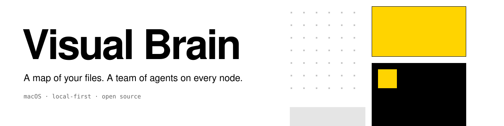
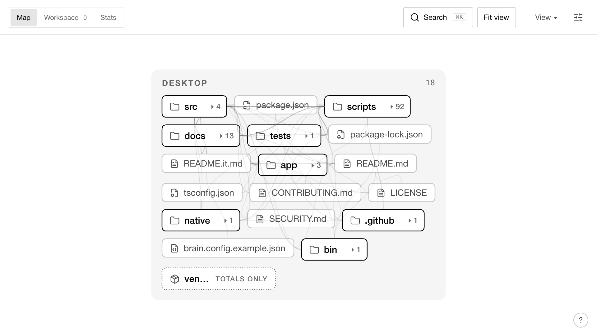

<picture>
  <source media="(prefers-color-scheme: dark)" srcset="docs/assets/banner-dark.svg">
  
</picture>

<p align="center">
  <a href="https://github.com/MichaelxBelmonte/VisualBrain-releases/releases/latest"></a>
  
  
  <a href="LICENSE"></a>
</p>

<p align="center">
  <a href="https://michaelxbelmonte.github.io/VisualBrain/"><b>Sito</b></a> ·
  <a href="https://github.com/MichaelxBelmonte/VisualBrain-releases/releases/latest"><b>Download</b></a> ·
  <a href="docs/TEAM.md">Squadre</a> ·
  <a href="docs/API.md">API</a> ·
  <a href="README.md">English</a> ·
  <b>Italiano</b>
</p>

Visual Brain è un'app per Mac che disegna una mappa dei file della Scrivania e ti fa avviare agenti AI da qualsiasi punto della mappa. Ogni file, cartella e progetto è un nodo. Le relazioni fra i nodi sono archi, ognuno con la sua evidenza e una confidenza: import, link, percorsi scritti nei file, copie, symlink, identificatori condivisi, contenuti simili e, se vuoi, inferenze di un modello. Da ogni nodo avvii Claude Code, Codex, Antigravity o Hermes già puntati su quel nodo, da soli o come squadra coordinata.

Tutto gira sul tuo Mac: Node 24, SQLite (`node:sqlite`), un canvas 2D e un walker Rust facoltativo.

<picture>
  <source media="(prefers-color-scheme: dark)" srcset="docs/assets/map-dark.png">
  
</picture>

<p align="center"><sub>La mappa di questo repository. Le linee continue sono collegamenti trovati nei file.</sub></p>

## Installazione

1. Scarica l'ultimo `Visual-Brain-X.Y.Z-mac-universal.zip` dalle [release](https://github.com/MichaelxBelmonte/VisualBrain-releases/releases/latest).
2. Estrailo e trascina **Visual Brain.app** in **Applicazioni** prima di aprirla.
3. Al primo avvio scegli italiano o inglese e le cartelle da mappare. Nessuna scansione parte prima della scelta.

Serve macOS 13.5 o successivo, su Apple Silicon o Intel. Node è incluso: non servono npm, Rust o strumenti da sviluppatore. L'app si aggiorna da sola da un feed firmato, sempre in Applicazioni, senza chiudere i terminali.

Il pacchetto usa un'identità autofirmata stabile e non è notarizzato, quindi macOS può chiederti di autorizzare il primo avvio in **Impostazioni di Sistema › Privacy e sicurezza**. La prima volta che legge la Scrivania macOS chiede il permesso; se l'accesso viene negato, un avviso nell'app spiega come concederlo.

## Cosa trovi

| Funzione | Cosa fa |
|---|---|
| **Mappa** | Una disposizione ordinata, non un grafo a forze. Le **aree** sono gruppi grigi, ogni **progetto** è un riquadro, le cartelle si aprono sul posto con i file annidati. Le linee continue sono fatti trovati nei file, le tratteggiate sono ipotesi (testo simile, AI), le puntinate sono regole. Le posizioni restano le stesse fra un avvio e l'altro. |
| **Ricerca** | `⌘K` trova file, cartelle e progetti. Il risultato si apre nella mappa. |
| **Pannello del nodo** | Dettagli, collegamenti con l'evidenza di ognuno, contenuto, note, *Apri nell'app*, *Mostra nel Finder* e *Operativa ↗* per avviare agenti sul nodo. |
| **Operativa** | Terminali veri (node-pty e xterm.js) accanto al nodo su cui lavorano, uno alla volta o fino a quattro affiancati. Sopravvivono alla chiusura e riapertura dell'app. |
| **Squadre** | Un orchestratore e più operatori sullo stesso nodo, ognuno con la sua CLI, il suo modello e il suo effort. Una bacheca per nodo (Da fare, In corso, Serve te, Fatto), un **Main Brain** che coordina le squadre, worktree Git facoltativi e promemoria. Vedi [docs/TEAM.md](docs/TEAM.md). |
| **Stats** | Richieste e token per progetto, squadra, sessione e account, letti dai registri che Claude Code e Codex tengono sul Mac. |
| **Harness del nodo** | Installa e apre DeepSeek Harness o Harness² da un nodo. Vedi [docs/HARNESSES.md](docs/HARNESSES.md). |
| **API locale** | Quella che gli agenti usano per arricchire il grafo. Vedi [docs/API.md](docs/API.md). |

## Cosa resta sul tuo Mac

- **L'indicizzazione non chiama mai un modello AI.** Le scansioni leggono solo le cartelle che hai scelto e non modificano nessun file.
- **L'analisi semantica è facoltativa.** Manda al modello solo metadati, più gli estratti dei README se lo consenti esplicitamente, e prima ti mostra esattamente cosa verrebbe inviato.
- **I segreti non vengono mai aperti.** Cartelle escluse, file `.env*`, chiavi e credenziali sono indicizzati solo per nome (classe `secret`).
- **I tuoi dati stanno in un posto solo.** Indice, impostazioni e bacheche sono in `~/Library/Application Support/Visual Brain/`, con i log in `logs/`.
- **Gli agenti sono tuoi.** Claude Code, Codex, Antigravity e Hermes sono facoltativi; li installi tu e accedi con il tuo account. Gli agenti che avvii possono modificare file, secondo le tue istruzioni e i permessi della loro CLI.

<details>
<summary><b>Agenti e account</b></summary>

Claude Code e Codex possono girare con più account in contemporanea: **Impostazioni → Agenti → scheda del provider → Aggiungi account**, poi scegli l'account dal menu Agente al momento dell'avvio. Ogni account, compreso il principale, si può rinominare lì; il nome compare accanto a ogni sessione Claude Code e Codex.

Le stesse schede mostrano la versione installata di ogni CLI e se ne è uscita una più recente. *Aggiorna* esegue in background il comando di aggiornamento della CLI, senza terminale; lo trovi anche in **Impostazioni → Aggiornamenti**. Le sessioni già aperte tengono la loro versione fino al riavvio.

</details>

## Avvio dal sorgente

```bash
npm install            # una volta
npm run build:ui       # compila l'interfaccia in dist/ui
node src/cli.ts index  # prima indicizzazione di ~/Desktop
node src/cli.ts serve  # http://127.0.0.1:4747
```

`npm run dev` avvia il server con l'interfaccia ricompilata a ogni modifica; `vb` (`bin/vb.js`) è la stessa CLI. Il server tiene d'occhio le cartelle mappate e reindicizza ciò che cambia (`--no-watch` lo spegne).

| Comando | Cosa fa |
|---|---|
| `vb index [--root DIR] [--subtree DIR] [--reextract] [--engine ts\|native\|auto]` | scansione incrementale, estrazione, progetti, archi, ranking |
| `vb serve [--port N] [--no-watch] [--watch-ui] [--open] [--index]` | server HTTP e WebSocket |
| `vb stats` | numeri dell'indice e archi per tipo |
| `vb analyze [--consent metadata\|excerpts] [--dry-run]` | analisi semantica con un modello; `--dry-run` stampa esattamente cosa verrebbe inviato |

Avvia il server da un terminale normale, non da dentro una sessione di Claude Code: gli agenti ereditano l'ambiente del server e partirebbero come sessioni figlie.

<details>
<summary><b>Creare l'app per Mac</b></summary>

```bash
npm install
rustup target add aarch64-apple-darwin x86_64-apple-darwin
npm run package:mac    # ZIP universale e checksum in release/
npm run install:mac    # crea il pacchetto, lo installa in /Applications e toglie la copia di build
```

`install:mac` tiene una sola Visual Brain sul Mac, quella in Applicazioni; i terminali aperti restano vivi (⌘R carica la nuova interfaccia). La build scarica Node da nodejs.org e ne controlla lo SHA-256. Senza un'identità di firma la build è firmata ad hoc; imposta `APPLE_SIGNING_IDENTITY` (e `VB_NOTARY_PROFILE` per notarizzare) per una build Developer ID. Release e feed degli aggiornamenti: [docs/RELEASES.md](docs/RELEASES.md).

</details>

<details>
<summary><b>Configurazione</b></summary>

In modalità CLI un `brain.config.json` facoltativo nella radice del progetto (escluso da git; parti da `brain.config.example.json`) sovrascrive i default di `src/server/config.ts`: `roots`, `port`, `excludePaths` (si aggiunge ai default: metti qui le cartelle private che non vuoi mai lette), `vendorNames`, `secretPatterns`, `containers` / `notContainers`, `llm` (`provider`: `claude-cli` | `anthropic-api` | `none`, `model`, `effort`, `consent`), `agents`. L'app desktop tiene le sue impostazioni in `settings.json` nel suo profilo.

Cartelle come `node_modules`, `target`, `venv` e `.build` contano solo come totale.

**Più brain (per esempio un Mac e una VM).** Il server gira anche senza l'app: `VISUAL_BRAIN_DATA_DIR=<profilo> node src/cli.ts serve --port N`, con `roots`, `setupComplete: true`, `"llm": {"provider": "none"}` e una `"label"` in `<profilo>/settings.json`. Accetta solo l'Host `127.0.0.1:N` / `localhost:N`, quindi un tunnel SSH deve usare la stessa porta dai due lati.

</details>

<details>
<summary><b>Test</b></summary>

```bash
npm run typecheck
npm run test:update    # aggiornamenti, posizione di installazione, permessi delle cartelle
npm run test:work      # operativa, squadre, terminali, interfaccia
npm run test:index     # motori di indicizzazione e qualità del grafo
```

Motori di indicizzazione, benchmark e limiti: [docs/INDEXING.md](docs/INDEXING.md), [docs/INDEXING-BENCHMARK.md](docs/INDEXING-BENCHMARK.md).

</details>

<details>
<summary><b>Struttura del repository</b></summary>

```
src/server/   scan · classify · extract · projects · graph · rank · cache · api · server
              terminals · launch · team · updater · access · llm/
src/ui/       main · layout · graph (canvas) · panel · search · terminal · work board · settings
src/shared/   types.ts (contratto UI/API)
app/          shell desktop Tauri (Rust)
native/       walker Rust facoltativo
site/         il sito, pubblicato su GitHub Pages
scripts/      script di build, pacchetto, rilascio e test
docs/         API, indicizzazione, squadre, harness, rilasci (per lo più in italiano)
```

</details>

## Contribuire

Issue e pull request sono benvenute, in inglese o in italiano: vedi [CONTRIBUTING.md](CONTRIBUTING.md). Per segnalare una vulnerabilità, vedi [SECURITY.md](SECURITY.md). Le note di rilascio sono in [docs/releases/](docs/releases/).

## Licenza

[MIT](LICENSE) © 2026 Michael Belmonte. Le grammatiche tree-sitter incluse hanno licenza MIT: [vendor/tree-sitter/LICENSES.txt](vendor/tree-sitter/LICENSES.txt).
