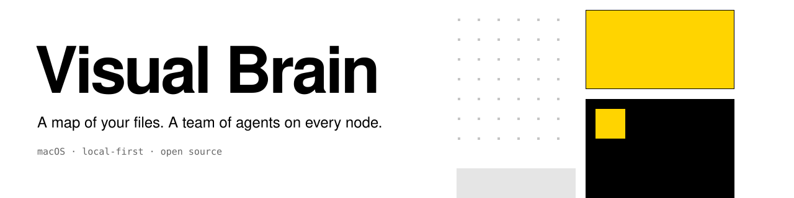
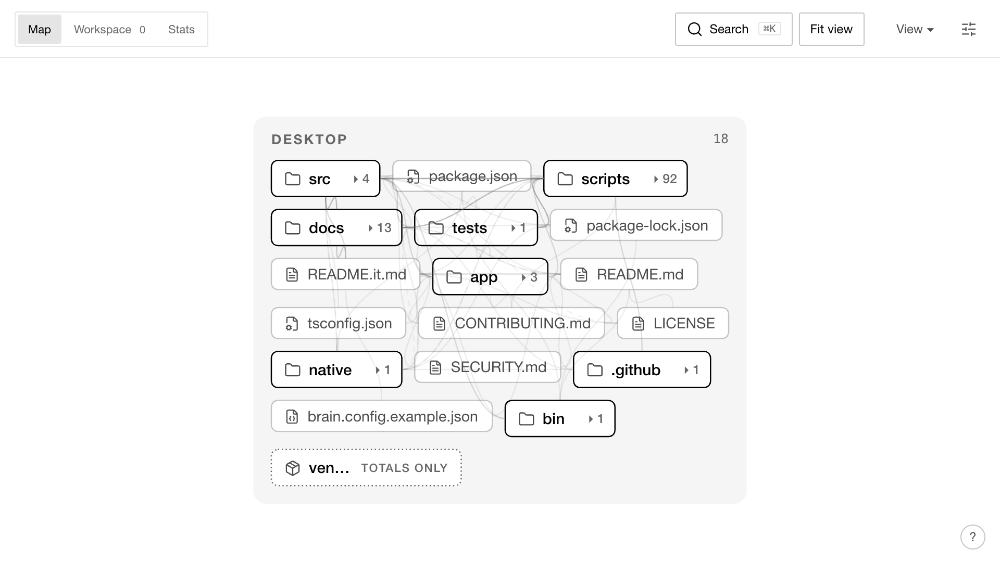

<picture>
  <source media="(prefers-color-scheme: dark)" srcset="docs/assets/banner-dark.svg">
  
</picture>

<p align="center">
  <a href="https://github.com/MichaelxBelmonte/VisualBrain-releases/releases/latest"></a>
  
  
  <a href="LICENSE"></a>
</p>

<p align="center">
  <a href="https://michaelxbelmonte.github.io/VisualBrain/"><b>Website</b></a> ·
  <a href="https://github.com/MichaelxBelmonte/VisualBrain-releases/releases/latest"><b>Download</b></a> ·
  <a href="docs/TEAM.md">Teams</a> ·
  <a href="docs/API.md">API</a> ·
  <b>English</b> ·
  <a href="README.it.md">Italiano</a>
</p>

Visual Brain is a Mac app that draws a map of the files on your Desktop and lets you start AI coding agents from any point of it. Every file, folder and project is a node. The relationships between them are edges, each with its evidence and a confidence: imports, links, paths written inside files, copies, symlinks, shared identifiers, similar content and optional AI inferences. From any node you start Claude Code, Codex, Antigravity or Hermes already pointed at that node, alone or as a coordinated team.

Everything runs on your Mac: Node 24, SQLite (`node:sqlite`), a 2D canvas and an optional Rust walker.

<picture>
  <source media="(prefers-color-scheme: dark)" srcset="docs/assets/map-dark.png">
  
</picture>

<p align="center"><sub>The map of this repository. Solid lines are links found in the files.</sub></p>

## Install

1. Download the latest `Visual-Brain-X.Y.Z-mac-universal.zip` from the [releases](https://github.com/MichaelxBelmonte/VisualBrain-releases/releases/latest).
2. Unzip it and drag **Visual Brain.app** into **Applications** before opening it.
3. On first launch choose Italian or English and the folders to map. Nothing is scanned before you choose.

Requires macOS 13.5 or later, on Apple Silicon or Intel. Node is bundled: no npm, Rust or developer tools needed. The app updates itself from a signed feed, always into Applications, without closing your terminals.

The package uses a stable self-signed identity and is not notarized, so macOS may ask you to approve the first launch in **System Settings › Privacy & Security**. The first time it reads your Desktop macOS asks for permission; if access is refused, a notice in the app explains how to allow it.

## What you get

| Feature | What it does |
|---|---|
| **Map** | An ordered layout, not a force graph. **Areas** are grey groups, each **project** is a box, folders open in place with their files nested. Solid lines are facts found in the files, dashed lines are hypotheses (similar text, AI), dotted lines are rules. Positions stay the same across launches. |
| **Search** | `⌘K` finds files, folders and projects. The result opens in the map. |
| **Node panel** | Details, links with the evidence for each one, content, notes, *Open in app*, *Show in Finder*, and *Workspace ↗* to start agents on the node. |
| **Workspace** | Real terminals (node-pty and xterm.js) next to the node they work on, one at a time or up to four side by side. They survive closing and reopening the app. |
| **Teams** | An orchestrator and operators on the same node, each with its own CLI, model and effort. A board per node (To do, In progress, Needs you, Done), a **Main Brain** that coordinates squads, optional Git worktrees, and reminders. See [docs/TEAM.md](docs/TEAM.md). |
| **Stats** | Requests and tokens per project, squad, session and account, read from the logs Claude Code and Codex keep on your Mac. |
| **Node harnesses** | Installs and opens DeepSeek Harness or Harness² from a node. See [docs/HARNESSES.md](docs/HARNESSES.md). |
| **Local API** | What agents use to enrich the graph. See [docs/API.md](docs/API.md). |

## What stays on your Mac

- **Indexing never calls an AI model.** Scans only read the folders you chose and never modify a file.
- **Semantic analysis is optional.** It sends only metadata to the model, plus README excerpts if you explicitly allow it, and shows you exactly what would be sent first.
- **Secrets are never opened.** Excluded folders, `.env*` files, keys and credentials are indexed by name only (class `secret`).
- **Your data has one home.** The index, settings and boards live in `~/Library/Application Support/Visual Brain/`, with logs in `logs/`.
- **Agents are yours.** Claude Code, Codex, Antigravity and Hermes are optional; you install each one and sign in with your own account. Agents you launch may modify files, according to your instructions and their CLI's permissions.

<details>
<summary><b>Agents and accounts</b></summary>

Claude Code and Codex can run under several accounts at once: **Settings → Agents → the provider's card → Add account**, then pick the account from the Agent menu when launching. Every account, the main one included, can be renamed there; the name is shown next to each Claude Code and Codex session.

The same cards show each CLI's installed version and whether a newer one is out. *Update* runs the CLI's own update command in the background, without a terminal; it is also listed in **Settings → Updates**. Sessions already open keep their version until restarted.

</details>

## Run from source

```bash
npm install            # once
npm run build:ui       # builds the interface into dist/ui
node src/cli.ts index  # first index of ~/Desktop
node src/cli.ts serve  # http://127.0.0.1:4747
```

`npm run dev` serves with the interface rebuilt on every change; `vb` (`bin/vb.js`) is the same CLI. The server watches the mapped folders and re-indexes what changes (`--no-watch` turns it off).

| Command | What it does |
|---|---|
| `vb index [--root DIR] [--subtree DIR] [--reextract] [--engine ts\|native\|auto]` | incremental scan, extraction, projects, edges, ranking |
| `vb serve [--port N] [--no-watch] [--watch-ui] [--open] [--index]` | HTTP and WebSocket server |
| `vb stats` | index numbers and edges by kind |
| `vb analyze [--consent metadata\|excerpts] [--dry-run]` | semantic analysis with a model; `--dry-run` prints exactly what would be sent |

Start the server from a regular terminal, not from inside a Claude Code session: agents inherit the server's environment and would start as child sessions.

<details>
<summary><b>Build the Mac app</b></summary>

```bash
npm install
rustup target add aarch64-apple-darwin x86_64-apple-darwin
npm run package:mac    # universal ZIP and checksum in release/
npm run install:mac    # package, install into /Applications, remove the build copy
```

`install:mac` keeps exactly one Visual Brain on the Mac, the one in Applications; open terminals stay alive (⌘R loads the new interface). The build downloads Node from nodejs.org and checks its SHA-256. Without a signing identity the build is ad-hoc signed; set `APPLE_SIGNING_IDENTITY` (and `VB_NOTARY_PROFILE` to notarize) for a Developer ID build. Releases and the update feed: [docs/RELEASES.md](docs/RELEASES.md).

</details>

<details>
<summary><b>Configuration</b></summary>

In CLI mode an optional `brain.config.json` in the project root (git-ignored; start from `brain.config.example.json`) overrides the defaults in `src/server/config.ts`: `roots`, `port`, `excludePaths` (added to the defaults: put the private folders you never want read here), `vendorNames`, `secretPatterns`, `containers` / `notContainers`, `llm` (`provider`: `claude-cli` | `anthropic-api` | `none`, `model`, `effort`, `consent`), `agents`. The desktop app keeps its settings in `settings.json` in its profile.

Folders such as `node_modules`, `target`, `venv` and `.build` count only as totals.

**Several brains (for example a Mac and a VM).** The server runs without the app: `VISUAL_BRAIN_DATA_DIR=<profile> node src/cli.ts serve --port N`, with `roots`, `setupComplete: true`, `"llm": {"provider": "none"}` and a `"label"` in `<profile>/settings.json`. It only accepts the Host `127.0.0.1:N` / `localhost:N`, so an SSH tunnel must use the same port on both sides.

</details>

<details>
<summary><b>Tests</b></summary>

```bash
npm run typecheck
npm run test:update    # updates, install location, folder permissions
npm run test:work      # workspace, teams, terminals, interface
npm run test:index     # indexing engines and graph quality
```

Indexing engines, benchmarks and their limits: [docs/INDEXING.md](docs/INDEXING.md), [docs/INDEXING-BENCHMARK.md](docs/INDEXING-BENCHMARK.md).

</details>

<details>
<summary><b>Repository layout</b></summary>

```
src/server/   scan · classify · extract · projects · graph · rank · cache · api · server
              terminals · launch · team · updater · access · llm/
src/ui/       main · layout · graph (canvas) · panel · search · terminal · work board · settings
src/shared/   types.ts (UI/API contract)
app/          Tauri desktop shell (Rust)
native/       optional Rust walker
site/         the website, published to GitHub Pages
scripts/      build, packaging, release and test scripts
docs/         API, indexing, teams, harnesses, releases (mostly in Italian)
```

</details>

## Contributing

Issues and pull requests are welcome, in English or Italian: see [CONTRIBUTING.md](CONTRIBUTING.md). To report a vulnerability, see [SECURITY.md](SECURITY.md).

## License

[MIT](LICENSE) © 2026 Michael Belmonte. Bundled tree-sitter grammars are MIT licensed: [vendor/tree-sitter/LICENSES.txt](vendor/tree-sitter/LICENSES.txt).
